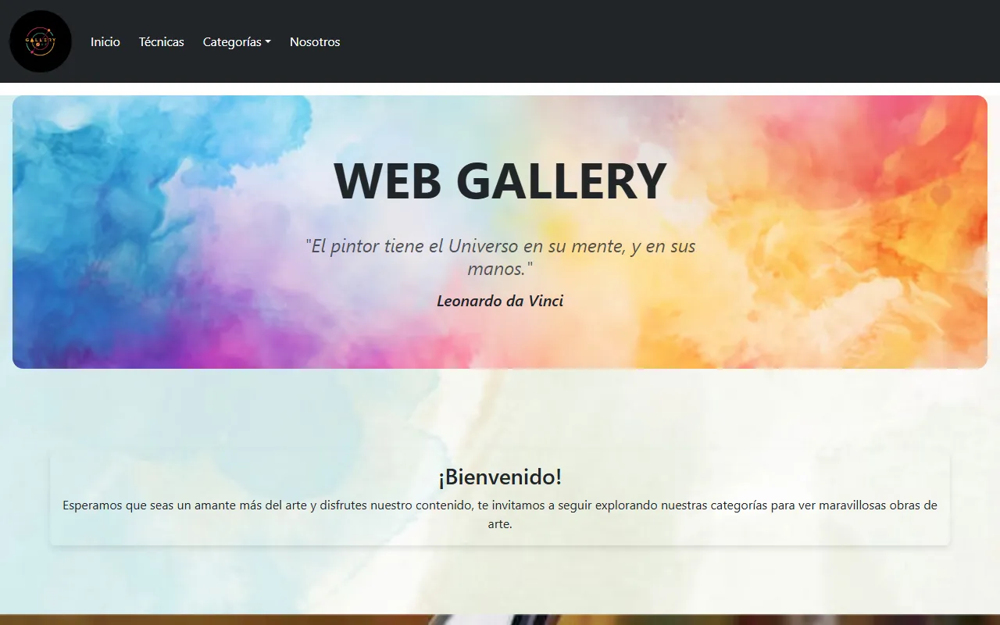
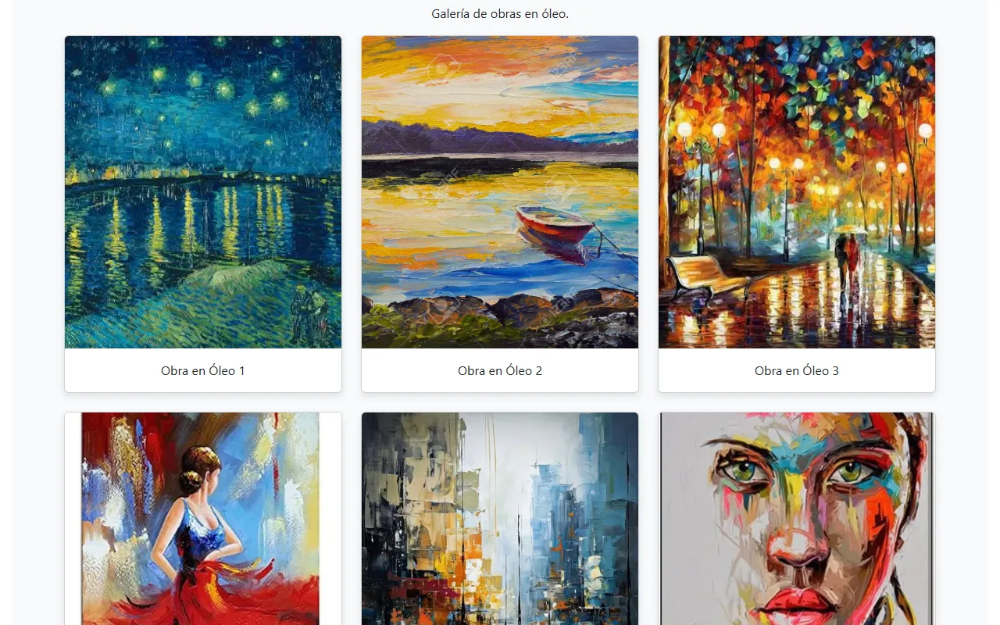
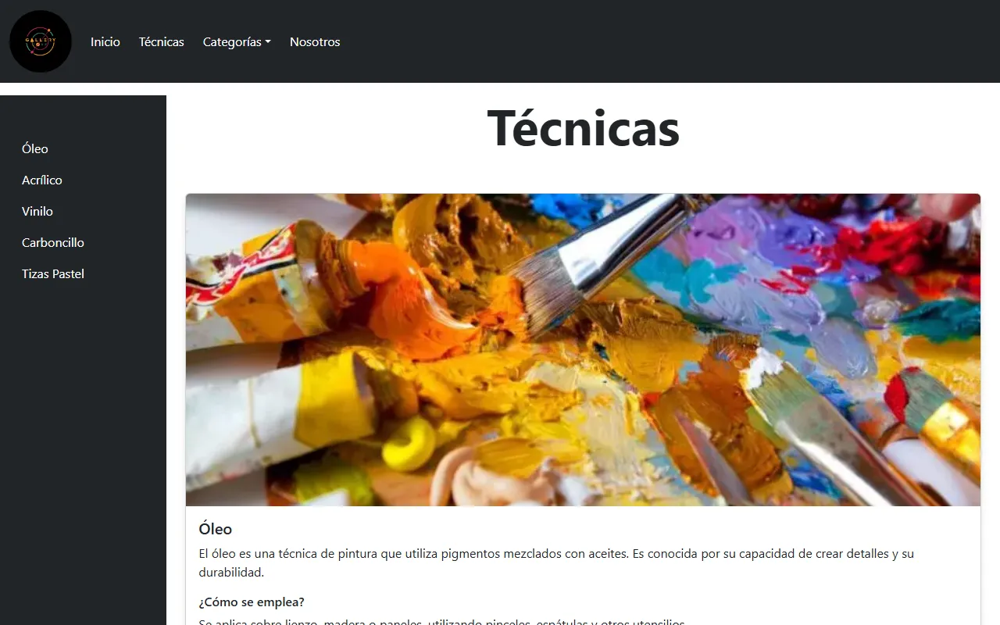
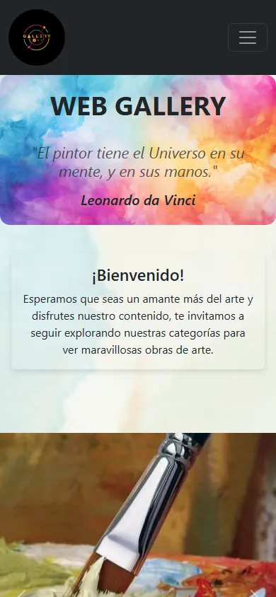
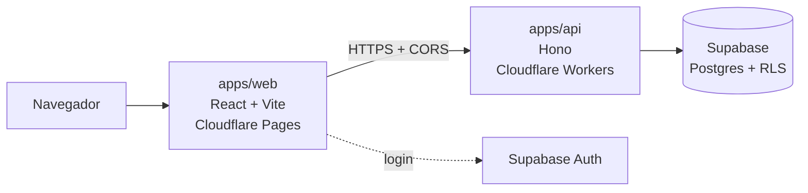

# Web Gallery

[](https://github.com/Luacm00/Proyecto_WebGallery/actions/workflows/ci.yml)
[](https://github.com/Luacm00/Proyecto_WebGallery/actions/workflows/deploy-api.yml)

Galería de arte web que reúne obras en cinco técnicas (óleo, acrílico, vinilo, carboncillo y tizas pastel) y explica cada una: qué es, cómo se emplea y qué materiales necesita.

El proyecto está evolucionando hacia una **plataforma para artistas**: podrán registrarse, subir sus obras clasificadas por técnica y recibir contactos de visitantes por WhatsApp, con un panel de administración para moderar el contenido.

**Demo:** [webgallery-2bc.pages.dev](https://webgallery-2bc.pages.dev)



## Funcionalidades

- Galería por técnica con visor de imagen ampliada (modal).
- Página de técnicas con navegación lateral a cada sección.
- Diseño responsive: navegación colapsable y galerías adaptadas a móvil.
- Rutas limpias con React Router, página 404 y redirecciones 301 de URLs antiguas.
- API en el borde con manejo de errores consistente, CORS por lista blanca y `requestId` por petición.
- Base de datos con **Row Level Security**: cada consulta se filtra según quién la hace (visitante, artista o admin).
- Cabeceras de seguridad en producción (Content Security Policy, `X-Frame-Options`, `nosniff`, HSTS).

## Capturas

| Galería | Técnicas | Móvil |
| --- | --- | --- |
|  |  |  |

## Arquitectura



- **Frontend y backend separados**, cada uno con su despliegue independiente.
- **API modular**: cada dominio (salud, categorías, obras…) es un módulo de Hono que se monta en la app principal.
- **Seguridad en la base de datos**: las reglas RLS y los triggers de protección se aplican aunque alguien se salte el frontend y la API.

## Tecnologías

| Capa | Tecnologías |
| --- | --- |
| Frontend | [React 18](https://react.dev), [Vite](https://vite.dev), [React Router 6](https://reactrouter.com), [Bootstrap 5](https://getbootstrap.com) / [React Bootstrap](https://react-bootstrap.github.io) |
| API | [Hono](https://hono.dev), [Cloudflare Workers](https://developers.cloudflare.com/workers/), TypeScript |
| Datos | [Supabase](https://supabase.com) (Postgres, RLS, Auth), migraciones SQL versionadas, pruebas con [pgTAP](https://pgtap.org) |
| Infraestructura | [Cloudflare Pages](https://pages.cloudflare.com), [GitHub Actions](https://github.com/features/actions), monorepo con [pnpm workspaces](https://pnpm.io/workspaces) |

## Ejecutar localmente

Requisitos: Node.js 22+, [pnpm](https://pnpm.io) y [Docker Desktop](https://www.docker.com/products/docker-desktop/) (para la base de datos local).

```bash
git clone https://github.com/Luacm00/Proyecto_WebGallery.git
cd Proyecto_WebGallery
pnpm install
pnpm exec supabase start   # Postgres, Auth y Studio en Docker
pnpm dev                   # web en http://localhost:3000 · API en http://localhost:8787
```

| Comando | Descripción |
| --- | --- |
| `pnpm dev` | Levanta el frontend y la API en paralelo, con recarga automática. |
| `pnpm build` | Genera la versión de producción del frontend en `apps/web/dist/`. |
| `pnpm --filter api typecheck` | Verifica los tipos de la API. |
| `pnpm exec supabase db reset` | Recrea la base local aplicando migraciones y datos de prueba. |
| `pnpm exec supabase test db` | Ejecuta las pruebas de seguridad (RLS) con pgTAP. |
| `pnpm exec supabase stop` | Detiene los contenedores de Supabase. |

## Estructura

```text
apps/
  web/                   Frontend (React + Vite)
    src/componentes/     Páginas y componentes
    public/              Imágenes, _headers (seguridad) y _redirects
  api/                   API (Hono en Cloudflare Workers)
    src/middleware/      CORS y manejo de errores
    src/modules/         Un módulo por dominio
    wrangler.jsonc       Configuración y entornos del Worker
supabase/
  migrations/            Esquema, reglas RLS y datos de referencia (versionados)
  tests/                 Pruebas de seguridad con pgTAP
  seed.sql               Datos de prueba solo para desarrollo local
.github/workflows/       CI, despliegue de la API, keep-alive y backups
```

## Despliegue y CI

1. Cada cambio se trabaja en una rama y llega a `master` mediante un Pull Request.
2. El CI ejecuta 3 checks obligatorios: **build del frontend**, **typecheck de la API** y **pruebas de seguridad de la base de datos**. La rama `master` está protegida: sin los 3 en verde no se puede hacer merge.
3. Al hacer merge, **Cloudflare Pages** publica el frontend y **GitHub Actions** despliega la API. Cada PR tiene además su propio preview.

Tareas automáticas:

- **Keep-alive diario:** consulta la base y la API (evita la pausa por inactividad y sirve como monitoreo básico).
- **Backup semanal:** exporta la base de datos, la cifra con AES-256 y la conserva 8 semanas.

## Créditos

Las imágenes de las obras se usan con fines educativos y pertenecen a sus respectivos autores.

---

Hecho por [Luacm00](https://github.com/Luacm00).
